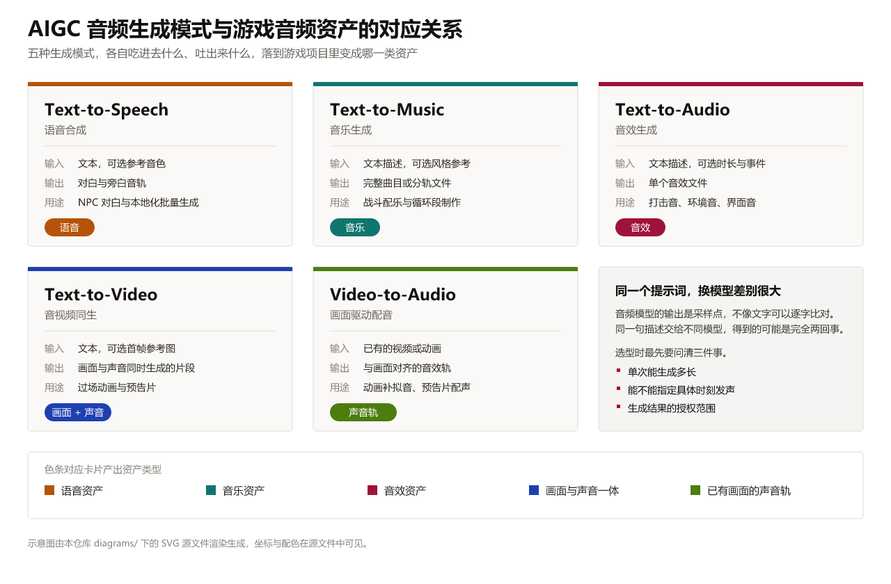
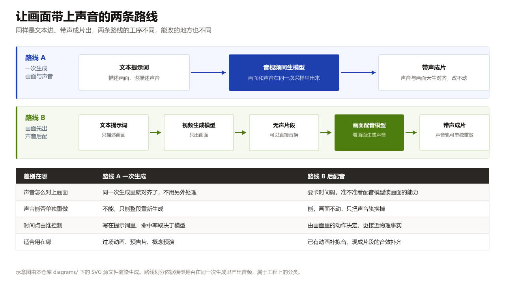
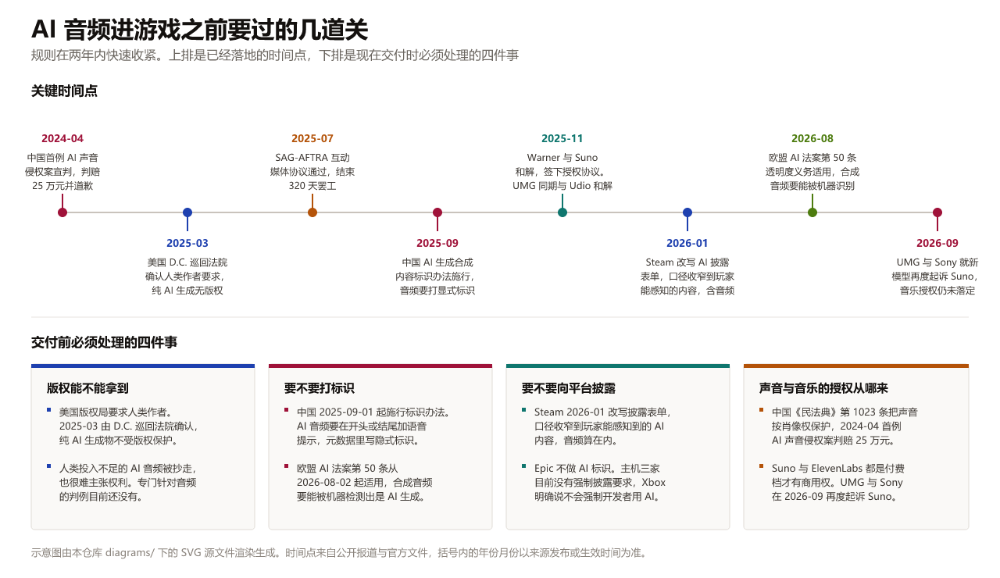
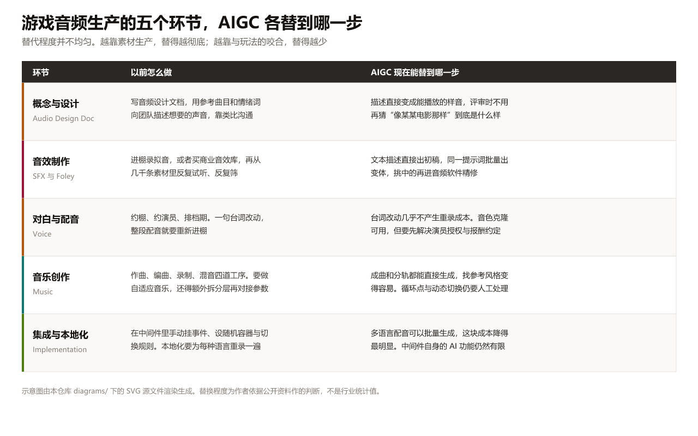

# 当下 AIGC 在游戏音频设计中的应用

一份按生成模式组织的调研

胡鑫 ｜ 24122330 ｜ 2026 年 10 月

---

## 先说一件让我改了整篇结构的事

我八月开始收材料，本打算按 Sora 2 对 Veo 3 那一代的格局来写音画同生。九月底再核一遍，Sora 的接口已经在 2026 年 9 月 24 日下线，移动端四月就关了，官方弃用表里替代品一栏是空的。这个题目里名气最大的名字，在我动笔前一个月消失，而且没有接替者。

这类题目不好写的地方就在这里。AIGC 音频的版本周期短到半年换一代，凭印象写会直接过时。本文凡带日期的地方，都是我在 2026 年 10 月上旬重新核过的。能相互印证的写进正文，只有单一来源或者查不到的，我在现场标出来。

下面按生成模式分章。同样是文本进、音频出，语音、音乐、音效三条线对模型的要求差别很大，混在一起讲会抹掉最关键的部分。

---

## 先分清两件事

### 游戏里的声音有三类，约束完全不同

**Voice 语音**负责对白和旁白，要求发音准确、情感到位、口型和画面对得上，几个角色的语气连着听还不能穿帮。这一类可以预先生成打包进游戏，也可以实时生成。

**Music 音乐**负责配乐。对游戏来说，它的要求落在结构清楚、循环点接得上、能跟着玩法状态切换这几件事上，单首好听排在后面。写得动不动人是审美问题，能不能在战斗和探索之间平滑过渡是工程问题，后者更要命。

**SFX 音效**负责打击、环境、界面这些短声音，要求短、准、成组一致。一把剑挥十次要十个变体，这十个还得听得出是同一把剑。这类需求量大、单价低、重复度高，理论上最该被自动化。

三类资产的约束不同，替代进度也就不同。这个差别是后面反复回到的一条线。

### 生成模式有五种

| 模式 | 输入 | 产出 | 主要对应资产 |
|---|---|---|---|
| Text-to-Speech | 文本，可选参考音色 | 对白音轨 | Voice |
| Text-to-Music | 文本描述，可选风格参考 | 曲目或分轨 | Music |
| Text-to-Audio | 文本描述，可选时长 | 单个音效文件 | SFX |
| Text-to-Video | 文本，可选首帧图 | 带原生音频的视频 | 过场与预告片 |
| Video-to-Audio | 已有画面 | 对齐的音效轨 | 现成画面的补声 |

这五种模式吃进去的东西不一样。选型时最先要问清三件事，单次能生成多长，能不能指定具体时刻发声，生成结果的授权范围。后面各章都围绕这三件事展开。

---

## 语音，格式上最成熟的一条线

### 现状

语音是三类资产里商业化最彻底的一类，也是唯一形成了公开延迟竞赛的一类。2026 年 10 月的头部产品给出的数字是这样。

| 产品与服务 | 首音延迟 | 商用与授权要点 |
|---|---|---|
| ElevenLabs Flash v2.5 | 约 75ms | 付费档可商用，免费档不可 |
| ElevenLabs Eleven v4 Turbo | 约 100ms | 2026-09-28 发布，90 余种语言 |
| Cartesia Sonic 3.5 | 端到端约 82ms | 支持私有化与 OEM 部署 |
| Inworld Realtime TTS-2 | 首字节 25ms | 按字符计价，2026-09-02 发布 |
| Deepgram Flux | 低至 80ms | 每千字符 0.045 美元 |
| 腾讯 Games Vox | 首包 140ms | 面向游戏场景，44kHz 输出 |
| OpenAI gpt-4o-mini-tts | 未公布 | 约每分钟音频 0.015 美元 |

表格把延迟列在最前面有原因。对游戏来说，延迟决定这条技术能用在哪。超过一秒就做不了玩家对着 NPC 说话的场景，对话节奏会碎掉。一百毫秒以内可以接近真人交谈的体感。

延迟数字本身有个陷阱。云端方案的响应时间主要由背后的大语言模型决定，公开实测给的区间是 0.8 到 2.5 秒，语音合成只占其中几十毫秒。语音模型已经快过它要接入的对话系统一个数量级，继续优化延迟的边际收益不大了。卡住实时 NPC 的是推理链路里的语言模型，发声这一步不是瓶颈。

成本方面，中文语音的接口价大致是每百万字符几十到一百多美元。一部长篇 RPG 如果全部对白都走接口，量级是几百到几千美元，比请配音演员进棚低很多。这个差价是现在行业里所有争议的根源。

### 已经落地的三种形态

按能查到公开来源的标准筛一遍，2024 到 2026 年确实上线过的案例集中在三个方向。

**当 NPC 的表现手段。** 网易《逆水寒》手游从 2023 年 2 月就在智能 NPC 上用 AI 生成对话文字、表情和语音，2024 年 10 月上线剧组模式，11 月上线音色迁移式的实时配音。网易在 2025 年第三季度财报里披露覆盖 90% 生产场景、场景设计效率提升 70%。这些是公司自述，不是第三方审计，看的时候要打折。

**当玩法本身。** 育碧 2025 年 11 月公布《Teammates》，玩家可以用语音指挥三个 AI 队友，前身是 GDC 2024 上的 NEO NPC 原型。到 2026 年 3 月，还没有正式发售的育碧游戏内置这套功能。Krafton 在《PUBG》里做的 Ally Duo 更实在，2026 年 6 月到 7 月在 Steam 上限时测试，AI 队友支持语音进出，端侧小语言模型基于 NVIDIA ACE，需要 8GB 显存以上的 RTX 显卡。同一家公司在 2026 年 7 月开源了 21B 参数的端到端语音模型 A.X K2 Raon-Speech，定位就是游戏角色的自然对话。

**当临时填充，然后被换掉。** Epic 在《堡垒之夜》里的做法值得单独说。2025 年 5 月上线会用 AI 声线对话的达斯·维达，用 Google Gemini 生成对话内容，用 ElevenLabs 复现 James Earl Jones 的声音，迪士尼拿到了授权。这一步本身合规，却引发了配音行业的公开批评，因为已故演员的声音被重新使用在行业里没有共识。2026 年 7 月，Epic 又给 36 个既有 NPC 加上了一致的 AI 配音。

反面的例子更能说明问题。Embark Studios 的《ARC Raiders》在 2025 年 10 月发售时用了 AI 生成语音，Steam 页面上有披露。发售后争议很大，工作室 2026 年 3 月开始用真人配音替换大量 AI 语音，到 10 月甚至把 NPC 模型改成贴合配音演员本人的长相，还补了全身动捕。CEO Patrick Soderlund 公开承认真人效果更好。这种掉头在行业里不常见，值得记下来。

### 还没解决的三件事

**口型同步。** 目前唯一能直接嵌进引擎的官方方案是 NVIDIA Audio2Face-3D，把流式音频转成面部 blendshape，C++ 和 Python 源码走 MIT 许可，虚幻引擎插件覆盖 5.4 到 5.7。微软 Azure 的语音服务也能输出 viseme 口型事件，但只支持美式英语，中文项目用不上。非英语项目的口型要么靠预烘焙，要么自己接一套。语音模型再快，这一步跟不上，画面就是假的。

**情感连续性。** 单句生成得好听，连着念二十句剧情对白会露馅，模型没有跨句的情绪记忆。这是很多项目宁可预生成整段对白再剪，也不逐句实时生成的原因。

**同意与授权。** 2026 年 9 月一份第三方横评检查了主流克隆服务的同意验证机制，只有 ElevenLabs、Fish Audio 和 Resemble AI 三家记录了技术性的同意校验，而且只针对专业级克隆。给十秒音频就能模仿的零样本克隆，在多数平台上没有强制校验环节。法律后果放到合规那一章。

---

## 音乐，能出歌了，但游戏要的不是歌

### 现状

音乐生成这两年变化剧烈。到 2026 年 10 月，主要玩家和版本是这样。

| 产品 | 当前版本与时间 | 商用要点 |
|---|---|---|
| Suno | v6 于 2026-09-09 发布 | 付费档下载才有商用权，免费档不可商用 |
| Google Lyria | 3.5，2026-09-04 向 API 开放 | 44.1kHz 立体声，全量带 SynthID 水印 |
| Udio | 2026-05 公布授权版应用 Starstruck | 与 UMG、WMG 已和解，与 Sony 仍在诉讼 |
| Mureka | V9.5 与 O3 预览，2026-08 | 昆仑万维产品，宣称打通商业发行 |
| MiniMax Music 3 | 2026-08-13，开放权重 | 可本地运行，由歌词加结构化描述生成完整歌曲 |
| 阿里 HappyShrimp | 1.0 测试版，2026-08-17 | 与太合音乐合作 |
| ACE-Step | 1.5 XL，2026-04-09 | Apache-2.0，4GB 显存可本地跑 |
| 网易天音 | 2026-06-15 升级四大能力 | 可一键发行到网易云音乐，设有激励金 |

看这张表的顺序要调整一下。对游戏来说，能不能生成一首完整的歌并不是重点，能不能拿到**分轨**和**可控参数**才是。原因是游戏音乐不是播完就算，它要在玩法状态之间切换。传统做法是作曲时就把音乐拆成若干层，比如节奏层、旋律层、紧张层，游戏引擎按玩家状态实时决定每一层放不放、音量多大。这个流程在音频中间件里叫自适应音乐。

所以值得记的进展是下面两条。

### 分轨导出，Suno Studio 2.0

Suno 在 2026 年 8 月 13 日发布的 Studio 2.0 是这一年里对游戏音频最实际的一次更新。它加了 MIDI 导入、录制和编辑，MIDI 片段还能反过来当生成提示。更重要的部分是分轨，它提供自动拆分、从混音拆分和高级拆分三档，自动拆分最多 12 轨，官方说高级拆分能单独抽出近一百种乐器。Premier 档位可以无限导出 32 位 48kHz 的多轨和分轨文件，导出来直接能进 Wwise 或 FMOD 做动态混音。

有一个技术细节值得写清楚。Suno 的分轨不是把混合好的音频切开来，官方说每一根分轨由模型重新生成。这个做法避开了分离算法常见的串音和水声伪影，代价是分轨叠加起来和原曲不完全一致。对游戏来说这个代价通常可以接受，游戏里本来就不会按原曲的原样播放。

### 实时可控参数，Lyria RealTime

另一半是 Google 的 Lyria RealTime。它是目前公开文档里唯一一个能被程序实时控制参数的音乐生成接口，走 WebSocket 长连接流式生成，播放过程中可以平滑切换加权提示词。参数包括每分钟 60 到 200 拍的速度、密度、明亮度、音阶、引导强度、温度和随机种子，还有三个很像分轨开关的参数，可以单独静音贝斯、静音鼓组，或者只保留贝斯和鼓组。

这个接口的形态已经接近自适应音乐的工程需求。它有速度参数、有分层开关、能在播放中改变，这三点正好对应引擎侧通常要控制的三个量。

要点明的是它现在仍标注为实验性接口，输出是 48kHz 立体声 PCM16，能不能扛住长期运营的稳定性没看到第三方验证。开放权重那一侧还有一个 Magenta RealTime 2，2026 年 6 月发布，可以本地运行。

### 一个不能忽略的实测结论

有一条学术结论需要放在这里，因为它直接否定了想当然的做法。

2026 年 3 月的一篇会议论文测了三种文生音乐模型在提示词被小幅改动时的输出变化，改法包括替换个别词、改变强度描述、调整结构描述。结论是模型对结构改写最敏感。表现最好的那个模型声学距离最低，音与音的语义相似度最高，跨随机种子的波动也最大。作者据此提出，把文生音乐用于自适应游戏音频时必须做多种子鲁棒性测试。

翻译成工程语言，同一个提示词生成两次可能得到风格不同的两段音乐，而游戏里玩家会连着听到它们。开场战斗和后续战斗的音乐如果听起来不是同一个世界，沉浸感就断了。这个问题目前没有标准解法，能想到的办法是固定随机种子、生成大批素材再筛，或者干脆预生成整套再进中间件。

### 版权这一半比技术那一半更乱

音乐方向的授权状态在 2026 年发生了实质变化，方向对游戏开发者是有利的。

唱片公司早期是全线开火。2024 年 6 月，环球、索尼、华纳三家分别起诉 Suno 和 Udio。2025 年底开始分化，环球与 Udio 在 10 月和解，华纳与 Udio 在 11 月和解，华纳又在 11 月 25 日与 Suno 和解并签了授权协议。2026 年 9 月发布的 Suno v6 就是这次合作的产物，与华纳、BMG、Believe 联合开发。

索尼没有跟上。2026 年 9 月 18 日，环球和索尼就 Suno 的新模型再次起诉，涉及 60202 条录音。欧洲那边更直接，2026 年 7 月 30 日慕尼黑法院在德国音乐版权组织 GEMA 起诉 Suno 的案子里认定，未经许可用受版权保护的作品训练模型构成侵权。这是欧洲第一例 AI 音乐版权判决。美国的走向也在收紧，2026 年 9 月 30 日第三巡回上诉法院在汤森路透诉 Ross 案中驳回了 AI 训练的合理使用抗辩，这是美国联邦上诉法院第一次就这个问题作出判决。

对做游戏的人来说，这几件事合起来的意思是，选 Suno 或 Udio 这类平台，商用权和分轨导出能力都绑在订阅档位上，Suno 明确只有付费下载的曲子才有商用权。选开放权重模型，绝大多数仍带非商用条款，AudioCraft、AudioLDM 2、MMAudio 的权重都是这样。到 2026 年 10 月，许可干净、允许商用、又开放权重的选项主要是 Stable Audio 3.0 的小号和中号，以及 ACE-Step。如果项目要实时自适应，可编程接口只有 Lyria RealTime 和 Magenta RealTime 2 两条路，前者实验性，后者要自己部署。

---

## 音效，最该被自动化，但生成不是最早落地的那个用法

### 现状

音效这一类的格局和语音、音乐都不一样。语音和音乐是几家商业公司领跑，音效这边开源生态的分量明显更重。

| 产品或模型 | 形态 | 商用要点 |
|---|---|---|
| Stable Audio 3.0 | 开放权重，2026-05-20 | 小号中号可下载，宣称用授权数据训练 |
| ElevenLabs Sound Effects | API | 0.1 到 30 秒可指定，支持超 30 秒无缝循环 |
| 腾讯混元 HunyuanVideo-Foley | 开权重，2025-08 与 09 | 48kHz，社区许可，含商用条件 |
| 字节 Doubao-Seed-Audio 1.0 | 云服务，2026-06-23 | 单一模型编排人声、环境、音效与音乐 |
| Adobe Firefly 音频 | 云服务，2026-08-20 GA | 官方强调授权清晰、商用安全 |
| Sony AI Woosh | 开放权重，2026-05-18 | 分私有版与公开版，明确面向游戏音效工作流 |

Stable Audio 3.0 值得单独说，它的能力组合正好对上游戏需求。它有四个型号，最小的两个是 433M 参数，能在 CPU 上跑，最长生成 120 秒。少见的地方在它支持三种操作方式，除了文本生成音频，还能做音频到音频的编辑和补全式续写。补全式续写对游戏很有用，游戏音效经常要延长，比如一段环境雨声要按玩家停留时间不确定地循环，能续写的模型比只能整段重生成的模型省事得多。它用的自编码器输出立体声 44.1kHz，够得上游戏标准。

Sony AI 在 2026 年 5 月发布的 Woosh 是这一年里最有针对性的一次尝试。官方明说目标是服务游戏音效总监和声音设计师的工作流，还分了私有版和公开版，私有版用商业音效库 Pro Sound Effects 和 BOOM 的授权素材训练。这个做法承认了一个现实，游戏公司在这件事上最怕的是来源说不清，好不好用排在第二位。

### 一个反直觉的观察，检索比生成先落地

按我的预期，音效生成应该最先被游戏行业大规模采用，因为需求量大、重复度高。实际情况不是这样。

2025 年 8 月，Audiokinetic 在 Wwise 2025.1 里上线了 Similar Sound Search，底层是索尼 AI 的 SFX-CLAP 模型，支持用音频找音频和用文字找音频。这是专业音频中间件里第一个这类工具。Audiokinetic 在官方 AI 声明里特意写明，这个功能用的是非生成式模型，可选安装，数据库里只有音频元数据。同一份声明里，他们强调没有把生成式音频放进主线产品。

这条事实值得停下来想一下。行业里最懂游戏音频工作流的公司，先做的是检索而不是生成。原因不难猜。音效库检索是音频设计师日常最费时间的环节，一个项目要翻几千条素材，而检索不产生新的版权风险，生成会。

### 生成真正卡住的地方

音效生成在技术上已经能出可用的初稿，问题不在音质，在**成组一致性**。

继续用那把剑的例子。玩家挥一次剑要触发一个音效，同一次攻击因为材质、力度、命中部位不同，需要五个到十个变体来避免重复感。这十个变体要满足三个条件，听起来是同一把剑、彼此有可听的差别、音量包络和时长能对齐。用生成模型做这件事，目前十个结果里能挑出三个合适的就算不错。剩下的要么太像，要么不像同一个东西，而且每次生成的音量和音头位置都不一样，得重新做一遍对齐和归一化。

这就解释了音效生成的落地方式为什么主要停在两个位置。一个是概念阶段的样音，用来跟团队沟通想要什么声音，这时候不需要成组一致。另一个是环境音和氛围层这类不在乎变体一致性的长音。吃量最大的打击音和交互音，还是靠音效库加人工筛选。

### 怎么衡量音效质量

这一块有比较稳定的共识。通用指标是 FD、KL 和 CLAP 分数，分别用 OpenL3、PaSST 和 CLAP-LAION 提取特征计算，测试集通常是 AudioCaps 和 MusicCaps。FD 衡量生成分布和真实分布的整体距离，KL 衡量多样性，CLAP 分数衡量生成结果和文本描述的语义匹配度。

2026 年 8 月发布的新基准 MMAG 加了时序关系维度，用约四千条人工核验片段测试模型能不能按时间戳安排声音事件。它的结论不太好听，目前没有任何模型在所有维度上稳定领先。这意味着不能看某一项跑分挑模型，得按自己最在乎的那一项去测。

还有一件事要单独提醒。源码和权重的许可差距在这一类里最大，同一个模型代码是 MIT 但权重是非商用许可很常见，MMAudio 就是这样。落地前要分别确认，不能只看仓库首页的许可证图标。

---

## 视频的原生音频，格局刚换过一轮

这一章开头已经提过 Sora 的事。把 2026 年 10 月的实际状态列清楚是这样。

| 模型 | 当前状态 | 音频能力与限制 |
|---|---|---|
| Gemini Omni Flash | 2026 年现行 | 原生音频，覆盖音效、音乐、旁白、对白，支持首尾帧控制 |
| Veo 3.1 | 现行主力，2025-10-15 | 单次 4、6 或 8 秒，音频强制开启无法关闭，仅留存两天 |
| Kling 3.0 与 4.0 | 2026 年现行 | 官方明示音画同步，支持多语混说，单次 3 到 15 秒 |
| Seedance 2.0 与 2.5 | 2026 年现行 | 官方称音视频联合生成架构，2.5 单次最长 30 秒加两次延长 |
| LTX-2 | 2025-10-23 | 自称首个扩散 Transformer 音视频基座，含同步音频最长约 10 秒 |
| Wan2.2 | 现行 | 反向路线，不做视频带音轨，做语音驱动视频，权重 Apache-2.0 |
| Sora 2 | 已下线 | 2026-04-26 关停应用，2026-09-24 下线接口，无替代 |

这张表里最该注意的是时长那一列。

Veo 3.1 单次只能生成 4、6 或 8 秒，1080p 和参考图输入还强制要求 8 秒，延长视频只在 720p 下支持。Seedance 2.5 是这轮里最长的，单次 30 秒加两次延长。LTX-2 大约 10 秒。一段像样的过场动画少说三四十秒，还要多镜头。

把音画同生直接当成过场动画的交付手段目前不成立。它实际能干的活是三样。单镜头素材，比如一个爆炸或者一次开门，直接拿生成的画面和声音。氛围层，垫在现有画面底下。概念预演，在正式制作之前把导演意图讲清楚。

另一个限制容易被忽略。Veo 3.1 的音频是强制开启的，官方文档写明生成时始终带音频，不能关。接口生成的视频只保留两天，还带 SynthID 水印。这两条对需要长期归档素材的制作管线是硬约束，两天之后想重新调就得重新生成，而生成结果不会完全一样。

### 音画同步同步到什么程度

官方口径只有一句准确的唇形同步。Google 没有公布实现方式，也没有公开精度数据。我查了一圈，没找到针对 Veo 3.1 或 Gemini Omni 的第三方唇形同步量化评测。

行业里衡量这类同步的指标是有标准的。唇形同步用 LSE-C 和 LSE-D，来自 2020 年 Wav2Lip 论文。视频到音频这条线有一套更完整的指标，包括 FD、KL、CLAP 分数，还有一个错位分数，用同步预测模型算出音频和画面平均偏移多少秒。

指标缺口对采购决策有直接影响。现在挑视频模型只能看演示视频，而演示视频是官方挑过的。该知道的是这个模型在角色快速说话时口型错多少、在爆炸这类瞬态事件上声音提前还是滞后。这些数据目前得自己测。

### 游戏行业里可查的实际用法

这块公开证据很少，我只找到一条能具名引用的一线用例。法国发行商 NACON 旗下有十五家工作室，他们用 Google 的 Veo 3 辅助制作电影化预告片，同时用 Gemini 做本地化。这是 Google Cloud 官方博客里的内容，时间在 2025 年 8 月。

同一篇博客里还有一条和音频关系更近的。Embody 公司的 Immerse AI Engine 用手机拍摄玩家头部和耳部的短视频，生成个性化的空间音频，已经用在《黑色行动 6》《赛博朋克 2077》《巫师 3》和《盗贼之海》等作品上。这个用法和生成音效无关，它做的是把通用混音改造成适配玩家自己耳朵的版本，属于个性化而不是创作。对音频设计师来说，这类工具改变的是交付形态，同一份音频要准备多个头部传递函数版本，工作量其实是增加的。

需要说明的是，我没有找到可引用的中国游戏公司用视频生成模型做过场动画的具名案例。这次检索里，机核、GameLook、游戏葡萄这几个来源的站内搜索没能用，所以这一块我只能标为未查到，不能推断它不存在。

---

## 反向链路，让画面自己去要声音

### 这条路线的位置

前面几章讲的是从文本出发。反过来的方向是给一段现成的画面生成声音，这条线在游戏里对应用的是拟音，也就是 Foley。

它的价值在于补上了前面那张图的另一半。原生音画同生的问题是声音不能单独重做，改了画面就要连声音一起重生成。反向路线正好反过来，画面先做好，声音慢慢配。两条路线配合起来，实际管线的形态是先用同生模型出带声的粗剪，确认方向之后重做画面，再用配音模型把声音轨补上。

### 现状

这一块的主力是开源模型，商业产品相对少。

MMAudio 在 CVPR 2025 上发表，用多模态联合训练加帧级同步模块对齐视频和音频的隐空间，8 秒片段的推理时间是 1.23 秒。它的代码是 MIT，权重是 CC-BY-NC 4.0，明确不能商用。腾讯的混元 HunyuanVideo-Foley 在 2025 年 8 月开源，9 月追加了支持显存卸载的 XL 版本，自研音频 VAE 输出 48kHz，权重许可是腾讯混元社区许可，含商用条件。阿里的 ThinkSound 在 NeurIPS 2025 上发表，用多模态大模型做链式推理，先做基础拟音，再以物体为中心交互式精修，最后按指令编辑，但仓库里写明不允许商用。

2026 年这个方向的研究重心明显转到可控性上了。FoleyDirector 用结构化剧本描述来管时序，Foley-Omni 从单事件合成升级到生成整条视频的音轨，WorldSonus 直接面向世界模型做实时声音生成。还有一个游戏专属的任务被提出来，叫换皮音效补全，讲的是游戏更新皮肤以后要保持玩法事件的语义不变、但重建整套音效的声学身份。这个任务描述基本就是把游戏音频设计师的实际工作写成了论文题目。

### 一个必须说清的限制

这条线目前最大的麻烦在授权，效果反倒是次要的。

按我手上能核实的资料，主流的视频到音频模型里能商用的非常少。MMAudio 权重非商用，ThinkSound 禁止商用，混元的社区许可带商用条件但需要逐条确认。开放权重里许可相对清楚的是 Stable Audio 3.0 的音频侧，和 LTX-2 系列。

我还查了一件事，这些模型有没有被官方集成进虚幻、Unity、Wwise 或 FMOD。结论是没有找到公开证据，相关集成都是社区插件，属于实验性质。所以这条路线现在还在研究阶段，不在生产管线的默认选项里。

---

## 引擎和中间件里，这些能力落到哪一步

这一章是我觉得最容易被写错的地方。很多二手文章把引擎的 AI 功能说得很大，拆开看，能力边界很清楚。

| 工具链 | AI 相关现状 | 性质 |
|---|---|---|
| Wwise | 2025.1 加 Sound Search，2026.1 加 MCP 支持 | 检索为非生成式，官方明确未把生成式音频放进主线 |
| FMOD | 2.04 无生成式音频功能 | 2026-10-01 母公司被 Bose 收购 |
| Unity | 6.2 起有 Unity AI 套件，含声音生成 | 编辑器内的生成式工具集 |
| 虚幻引擎 | 音频仍是 MetaSounds 与音频分析 | 引擎本身不生成，UE6 定位把生成式 AI 列为核心 |
| 团结引擎 | 官方特性含 AI Generator 与 AI Graph | 与腾讯混元等合作的多模态资产生成 |

把这张表读成一个结论，游戏引擎和音频中间件的**主线产品**到 2026 年 10 月仍然没有把生成式音频放进去。Wwise 的官方声明写得最清楚，他们上线的是检索，且是非生成式的。FMOD 的 2.04 版本更新的是混音沙盒、资源标记和自动化精度，和 AI 无关。虚幻引擎自己的音频系统还是 MetaSounds 那套节点图加音频分析。Unity 是唯一一个把声音生成放进官方工具套件的，那是编辑器里的辅助工具，和运行时音频系统是两件事。

生成能力都在引擎外面，通过接口或者插件接进来。这带来两个后果。音频资产管线分裂成两段，一段在生成服务上，一段在引擎里，两边同步得自己搭。所有生成结果的合规标识、来源记录、许可核验也要在管线里自己实现，引擎不提供。

2026 年有两条新动向。Wwise 2026.1 测试版加了 MCP 支持，让 AI 代理可以操作 Wwise，这是把 AI 当操作者而不是当生成器。Epic 在 2026 年 6 月的虚幻引擎 5.8 发布活动上明确，虚幻引擎 6 会把生成式 AI 和语言模型放在核心位置。这条对后面两三年影响很大，但目前还没有落地功能可以评。

还有一条容易被忽略的。中间件侧在跑的口型方案是 ReadSpeaker 的 Wwise 插件，做端上语音合成，支持 26 种语言和 48 个声音，输出词级和 viseme 数据驱动口型。它不带生成式属性，但这是目前唯一能在中间件里直接用的方案。

---

## 合规，这几道关已经生效了

这一章的内容是硬性的，和审美无关。我把已经生效的规则按类别列出来。

### 标识义务

中国在 2025 年 3 月 7 日印发《人工智能生成合成内容标识办法》，2025 年 9 月 1 日起施行，共 14 条。对音频的要求是在起始、末尾或者中间适当位置添加语音提示或者音频节奏提示等标识，对视频要求在起始画面和播放周边的适当位置添加显著提示。文件被下载、复制、导出时必须含符合要求的显式标识，元数据里还要写入隐式标识，包括生成合成属性信息、服务提供者名称或编码、内容编号。办法同时要求传播平台核验元数据，相关日志留存不少于六个月，禁止恶意删除、篡改、伪造、隐匿标识。

这条对游戏的影响是具体的。游戏里的 AI 配音没有加提示音，理论上不合规。实际操作里怎么安排这个提示、放在哪、要不要玩家能关掉，公开讨论还很少。这是个还没解决的实际问题。

欧盟那边，AI 法案第 50 条的透明度义务从 2026 年 8 月 2 日起适用。生成合成音频的提供者必须对输出做机器可读的标记，且能被检测出是 AI 生成。对艺术、创作和虚构类作品，只须以不干扰欣赏的方式披露。AI 系统直接与人交互时要告知对方这是 AI。

### 版权

美国的方向比较清楚。2025 年 3 月 18 日，哥伦比亚特区巡回上诉法院在 Thaler 诉 Perlmutter 案中确认，纯 AI 生成、没有人类创作投入的作品不能获得版权，人类作者是成文法要求。推论到音频上是这样，AI 生成的对白和音乐如果人类投入不足，很难拿到美国版权保护，被别人抄走也难主张权利。到目前为止没有专门针对 AI 音频的判例。

### 声音权

这一块中国走得比多数国家更早，也更明确。

《民法典》第 1023 条第二款规定，对自然人声音的保护参照适用肖像权保护的有关规定。2024 年 4 月 23 日，北京互联网法院对全国首例 AI 生成声音侵权案作出一审判决，认定在具备可识别性的前提下，自然人的声音权益可以延伸到 AI 生成的声音，被告未经授权开发文本转语音产品构成侵权，判赔 25 万元并书面道歉。这个案子已经入选法院入库案例。

2026 年又多了几件。上海浦东新区法院在 9 月判决一起 AI 变声软件案件，被告未经授权用《原神》角色的一分钟音频训练模型，判赔米哈游 75 万元，认定角色音色具有商业标识功能。另一起案子判 AI 平台运营方赔偿配音演员 5 万元。9 月 7 日最高人民法院发布了涉 AI 纠纷案件的意见。日本东京地方法院在 9 月 30 日作出首例裁定，认定声音受公开权保护，但驳回了声优要求删除 AI 克隆视频的请求，说明权利认定和具体救济之间还有距离。

把这些连起来看，用知名角色的声音、用可识别到具体人的声线去做 AI 语音，在中国是有明确判例的侵权风险，赔偿量级从 5 万到 75 万。

### 平台披露

Steam 从 2024 年 1 月起要求开发者披露 AI 内容，2026 年 1 月中旬改写了披露表单，明确只针对玩家能感知到的 AI 生成内容，包括美术、音频、对白、本地化和商店素材，开发效率类的 AI 工具豁免。这个口径比原来收窄了。

Epic 游戏商店不做 AI 标识，Tim Sweeney 在 2025 年 11 月公开说 Steam 的 AI 标签不负责任，理由是未来几乎所有生产都会涉及 AI。主机三家目前没有强制披露要求，微软游戏部门负责人表示不会要求开发者使用 AI。

第三方统计给出的 Steam 数据是，带 AI 披露的新作占比从 2024 年的 10.9% 涨到 2025 年的 19.9%，2026 年到 30.8%。这些是第三方统计，口径未必统一。

### 劳工与同意

SAG-AFTRA 的游戏配音与动作捕捉罢工从 2024 年 7 月持续了将近一年，2025 年 7 月 9 日会员以超过 95% 的赞成票通过了新的互动媒体协议。协议里关于数字复制品的条款是核心，要求创建之前必须取得独立、明确、书面的同意，还规定了披露、补偿和报告义务，并允许在罢工期间暂停对生成新素材的同意。

这个协议约束的是签约的美国制作方。用 AI 生成声音的项目如果涉及工会演员，条款是硬约束。

---

## 这对做游戏音频的人来说意味着什么

前面几章的结论汇总到一个问题上，就是这条产业链上的活怎么重新分配。

**谁多做了一项工作。** 音频设计师的位置上确实多出了几步。传统流程是从音效库里挑素材或者进棚录，现在多出了写提示词、批量生成、筛选、做一致性对齐、记录来源这一串。这些活技术含量不高但很占时间，而且生成结果不合规要自己负责。Embody 那种个性化空间音频是另一个方向的例子，同一份资产要交付多个版本，工作量是纯增。

**谁可能失去订单。** 受冲击最直接的是三层。小语种和次要角色的配音外包，因为批量生成的成本接近零，只有主要角色的表演还值得进棚。音效库的销售，生成能覆盖一部分初稿需求，采购量会降。低成本的拟音外包，视频到音频这类模型的直接对手就是它。已经能看到的应对是，2026 年 9 月有声音设计师和音效库成立了行业组织，明确针对 AI 抓取数据。

**谁付钱，谁负责。** 钱还是项目出，支出的结构在变。接口调用费是运营成本，比一次性购买音效库更持续，越大的项目长期越贵。责任的归属更麻烦，如果生成的对白撞上了某个演员的声线，如果用生成音乐收到了起诉，风险落在发行方而不是工具方，因为主流服务条款都把责任转给了使用者。

**旧办法在哪一步最难受。** 让我最在意的是一个数字上的背离。2026 年初的 GDC 行业调查显示，52% 的从业者说公司或者部门在用生成式 AI，36% 的人自己在工作中用。同一份调查里，认为生成式 AI 对行业有负面影响的比例也是 52%，而这个数字在 2024 年是 18%，2025 年是 30%，正面评价降到了 7%。

更细的一层是用法分布。同一份调查里，用生成式 AI 最多的场景是研究和头脑风暴，占 81%，写代码辅助占 47%，生成面向玩家的资产只占 19%，做面向玩家的功能只有 5%。另一个专门针对游戏音频的行业调查给出的说法是，AI 在游戏音频里的使用相对少见，最常见的是对白生成和代码脚本。

这两组数据放在一起解释得通。AI 在游戏音频里目前主要发生在准备工作阶段和语音这一类资产上，进入玩家耳朵、需要和玩法咬合的部分用得非常少。这也和前面各章的技术结论对得上，语音已经够用，音乐卡在分轨和自适应，音效卡在成组一致性，视频卡在时长。

### 我的判断，以及它可能错在哪

我的判断是这样。到 2026 年 10 月，AIGC 在游戏音频里已经完成了两类替代，替换的是临时素材和次要语音，这两块的替代稳定且不可逆。接下来两三年最可能突破的位置是音效的批量变体生成，前提是出现能保证成组一致性的方案。最难动的是自适应音乐和关键角色的表演，这两件事的价值本来就不在声音本身，在于它和玩法的咬合精度以及演员的表演判断，目前没看到可替代的路径。

这个判断可能错在三个地方。

如果视频生成的时长瓶颈在一年内被突破，过场动画的生产方式会整个变。动画和声音一起生成，就不需要演员先把表演录出来，这对我上面关于关键角色表演的判断是不利的。Seedance 2.5 已经做到单次 30 秒，如果下一代到两分钟，情况就不一样。

如果把成组一致性当成一个可训练的子任务解决掉，音效这块的替代速度会比我估的快得多。换皮音效补全那个任务方向已经有人在做了。

还有一点我可能低估，就是玩家的接受度。我引用的两份调查结论相反，一份说 63% 的玩家对生成式 AI 整体非常负面，另一份初步研究说 90% 以上的玩家觉得 AI 角色有趣且值得。这两个数字口径不同，不能直接比较，至少说明玩家的态度不是一堵墙。挡住它的可能是从业者的态度，而从业者的态度会影响产品决策。

最后一点要标明白。本文关于采用率的数字都来自问卷，样本量在六百到三千之间，对象以欧美开发者为主。中国游戏公司的实际使用情况，除了网易自己披露的那组数据，我没有找到可核验的第三方统计。这是一个明显的空白。

---

## 参考来源

以下按本文章节顺序列出对结论有支撑作用的来源。标注了发布或生效时间的，以该时间为准。

### 生成模式与资产分类

- Embody 与 Google Cloud 游戏合作伙伴用例，https://cloud.google.com/blog/products/gaming/games-start-ups-developers-partners-innovating-with-gen-ai （2025-08-18）

### 语音

- ElevenLabs 模型文档与定价，https://elevenlabs.io/docs/models 与 https://elevenlabs.io/pricing （2026-10）
- TTS 模型横评与价格，https://www.marktechpost.com/2026/05/30/best-text-to-speech-tts-models-in-2026-a-benchmark-based-comparison/
- Inworld Realtime TTS-2 发布稿，https://www.financialcontent.com/article/bizwire-2026-9-2-inworld-launches-realtime-tts-2-voice-model-family-for-controllable-realtime-speech （2026-09-02）
- 腾讯 Games Vox 报道，https://baijiahao.baidu.com/s?id=1874925627934688478 （2026-08-30）
- 网易《逆水寒》手游 AI 功能报道，https://www.ithome.com/0/804/879.htm 与 https://h.163.com/news/official/20251028/37231_1267366.html
- 育碧《Teammates》公布，https://news.ubisoft.com/en-us/article/3mWlITIuWuu0MoVuR6o8ps/ubisoft-reveals-teammates-an-ai-experiment-to-change-the-game
- Krafton PUBG Ally 开发报道，https://www.invenglobal.com/articles/22987/ai-pubg-teammate-raised-through-tens-of-thousands-of-matches-at-internet-cafes-krafton-reveals-development-story
- 《堡垒之夜》AI 配音报道，https://www.videogameschronicle.com/news/fortnite-has-started-adding-ai-voices-to-its-npcs-for-an-upcoming-conversations-feature/
- 《ARC Raiders》替换 AI 语音，https://www.gosugamers.net/entertainment/news/78134-arc-raiders-ai-voicelines-are-being-replaced-with-human-voice-actors
- NVIDIA ACE 与 Audio2Face，https://developer.nvidia.com/ace
- 克隆同意校验横评，https://www.marktechpost.com/2026/09/21/best-voice-cloning-apis-in-2026-speaker-similarity-consent-checks-and-price-per-1m-characters/
- 游戏配音与 AI 行业报告，https://www.shanethegamer.com/research/ai-voice-acting-report/ （2026-09-13）

### 音乐

- Suno v6 发布，https://suno.com/blog/introducing-v6 （2026-09-09）
- Suno Studio 2.0，https://suno.com/blog/studio-2 （2026-08-13）
- Suno 分轨说明，https://suno.com/blog/stem-separation-updates （2026-06-11）
- Suno 服务条款更新，https://suno.com/blog/suno-updates-tos （2026-08-10）
- Google 音乐生成接口文档，https://ai.google.dev/gemini-api/docs/music-generation （2026-10-01）
- Google 实时音乐生成接口文档，https://ai.google.dev/gemini-api/docs/realtime-music-generation （2026-09-18）
- ElevenLabs Music v2，https://elevenlabs.io/blog/introducing-music-v2 （2026-05-26）
- 自适应游戏配乐实测论文，https://arxiv.org/abs/2603.13824 （2026-03）
- GEMA 胜诉 Suno，https://variety.com/2026/digital/news/suno-loses-ai-lawsuit-gema-1236825010/ （2026-07-30）
- 环球与索尼二次起诉 Suno，https://thenextweb.com/news/universal-sony-second-lawsuit-suno-60202-recordings （2026-09-18）
- 第三巡回法院合理使用判决，https://www.courthousenews.com/ai-training-of-copyrighted-material-not-fair-use-third-circuit/ （2026-09-30）
- 华纳与 Suno 和解，https://suno.com/blog/wmg-partnership （2025-11-25）

### 音效

- Stable Audio 3.0 发布与仓库，https://github.com/Stability-AI/stable-audio-3 与 https://arxiv.org/abs/2605.17991 （2026-05-20）
- ElevenLabs 音效能力文档，https://elevenlabs.io/docs/capabilities/sound-effects
- Sony AI Woosh，https://ai.sony/blog/introducing-woosh-sony-ais-sound-effect-foundation-model （2026-05-18）
- Wwise Similar Sound Search 与官方 AI 声明，https://www.audiokinetic.com/en/solutions/use-of-ai 与 https://www.pocketgamer.biz/sony-ai-and-audiokinetic-launch-ai-powered-similar-sound-search-for-wwise/ （2025-08）
- 腾讯混元 HunyuanVideo-Foley，https://github.com/Tencent-Hunyuan/HunyuanVideo-Foley
- 字节 Doubao-Seed-Audio 与 SwanTale，https://www.techtimes.com/articles/323058/20260804/bytedance-unified-audio-ai-collapses-voice-sound-music-one-model-swantale.htm （2026-08-04）
- Adobe Firefly 音频套件 GA，https://9to5mac.com/2026/08/20/adobe-fireflys-music-voiceover-and-sound-effects-generation-tools-now-generally-available/ （2026-08-20）
- 音效评测指标与工具，https://github.com/Stability-AI/stable-audio-metrics
- MMAG 基准，https://arxiv.org/abs/2608.06900 （2026-08-07）
- 端侧模型 TinyAudio，https://arxiv.org/abs/2609.31525 （2026-09-25）

### 视频与音画

- Google 视频生成接口文档，https://ai.google.dev/gemini-api/docs/veo 与 https://ai.google.dev/gemini-api/docs/models
- Gemini Omni，https://deepmind.google/models/gemini-omni
- OpenAI 弃用表，https://developers.openai.com/api/docs/deprecations
- 可灵系列，https://klingapi.com/zh 与 https://klingai.com/
- 字节 Seedance，https://seed.bytedance.com/en/seedance2_0 与 https://seed.bytedance.com/en/seedance2_5
- LTX-2，https://github.com/Lightricks/LTX-Video 与 https://huggingface.co/Lightricks/LTX-2.3
- Wan2.2，https://github.com/Wan-Video/Wan2.2
- NACON 使用 Veo 3，https://cloud.google.com/blog/products/gaming/games-start-ups-developers-partners-innovating-with-gen-ai （2025-08-18）
- ElevenLabs 游戏案例，https://elevenlabs.io/gaming
- 视频到音频评测基准，https://github.com/hkchengrex/AV-Benchmark
- MMAudio，https://arxiv.org/abs/2412.15322 与 https://github.com/hkchengrex/MMAudio
- Frieren，https://arxiv.org/abs/2406.00320
- ThinkSound，https://github.com/FunAudioLLM/ThinkSound
- 换皮音效补全，https://arxiv.org/abs/2609.39044 （2026-09-30）
- SynthID，https://deepmind.google/technologies/synthid/
- Gemini API 条款，https://ai.google.dev/gemini-api/terms

### 引擎与中间件

- Wwise 2025.1 与 2026.1，https://www.audiokinetic.com/en/community/blog/wwise-2025.1-media-pool-similar-sound-search 与 https://www.audiokinetic.com/en/community/blog/wwise-2026.1-whats-new/
- FMOD Studio 2.04，https://www.fmod.com/docs/2.04/studio/welcome-to-fmod-studio-new-in-204.html
- Bose 收购 Firelight Technologies，https://www.prnewswire.com/news-releases/bose-corporation-announces-acquisition-of-firelight-technologies-302893112.html （2026-10-01）
- Unity AI 套件，https://unity.com/features/ai 与 https://www.cgchannel.com/2025/08/unity-rolls-out-unity-ai-in-unity-6-2/
- 虚幻引擎 5.8，https://www.unrealengine.com/news/unreal-engine-5-8-is-now-available （2026-06-18）
- Epic 关于生成式 AI 的表述，https://www.thegamer.com/epic-games-unreal-engine-6-ue-generative-ai-models-central-make-content-faster/
- 团结引擎帮助中心，https://unity.cn/tuanjie/help-center

### 合规

- 《人工智能生成合成内容标识办法》，https://www.cac.gov.cn/2025-03/14/c_1743654684782215.htm （2025-09-01 施行）
- 欧盟 AI 法案第 50 条，https://artificialintelligenceact.eu/article/50/ （2026-08-02 适用）
- Thaler 诉 Perlmutter 判决，https://media.cadc.uscourts.gov/opinions/docs/2025/03/23-5233.pdf （2025-03-18）
- 全国首例 AI 生成声音侵权案，https://peking.bjd.com.cn/content/s6867e685e4b0bd64e2e07e62.html （2024-04-23）
- 上海浦东法院《原神》音色案，https://www.ali213.net/news/html/2026-9/1038345.html （2026-09）
- 日本声音公开权首例裁定，https://apnews.com/article/japan-anime-voice-actor-ai-a2a9596a197f149398771a9166043ef9 （2026-09-30）
- SAG-AFTRA 互动媒体协议通过，https://www.reuters.com/business/media-telecom/industry-video-game-actors-pass-agreement-with-studios-ai-security-2025-07-10/ （2025-07-10）
- Steam 披露口径调整，https://www.gamedeveloper.com/business/valve-tweaks-and-clarifies-ai-disclosure-rules-for-steam （2026-01）
- Epic 对 AI 标识的立场，https://www.gamesradar.com/games/opposing-steams-ai-disclosures-epic-ceo-tim-sweeney-says-game-stores-should-drop-the-ai-tag-because-it-makes-no-sense-when-ai-will-be-involved-in-nearly-all-future-production/
- Xbox 开发者政策，https://learn.microsoft.com/en-us/gaming/gdk/docs/store/policies/xr/xr018?view=gdk-2604 （2026-07-22）
- Google Play AI 内容政策，https://support.google.com/googleplay/android-developer/answer/14094294

### 行业数据

- GDC 2026 行业调查，https://gdconf.com/article/gdc-2026-state-of-the-game-industry-reveals-impact-of-layoffs-generative-ai-and-more/
- GDC 2025 行业调查，https://investgame.net/wp-content/uploads/2025/03/0794a269-d5c4-4994-9bcf-8c5730d0815e_2025_GDC_State_of_the_Game_Industry_report-1.pdf
- GameSoundCon 2025 游戏音频调查，https://www.gamesoundcon.com/game-audio-survey-2025

---

本文配图由本目录 `diagrams/` 下的 SVG 源文件渲染生成，正文中另有 `docs/` 下的调研资料整理与示意图说明。

> 本文为课程作业调研报告。所有事实性论断均标注来源与时间，未标注来源处为作者依据公开材料作出的判断，边界已在相应位置说明。
